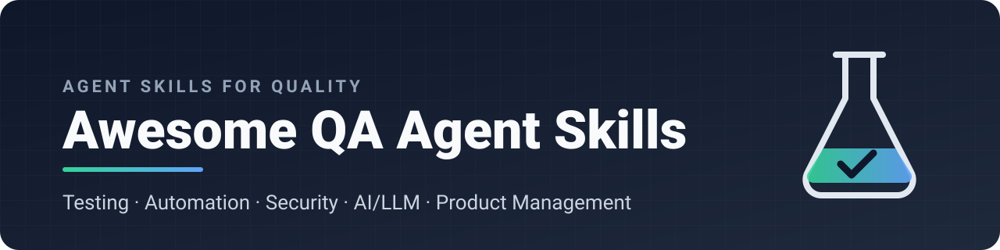
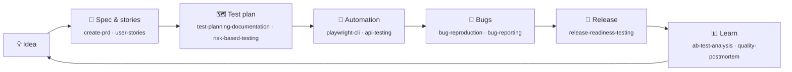

<div align="center">



### Turn your AI coding agent into a senior QA engineer and a sharp product partner.

<!-- count -->194<!-- /count --> curated, validated Agent Skills for <b>software testers, SDETs, QA leads and product managers</b>, in <!-- cats -->21<!-- /cats --> categories, installed with one command into <b>Claude Code</b> and <b>Antigravity</b>.

[](#-catalog)
[](#-catalog)
[](#-credits)
[](.github/workflows/validate.yml)
[](LICENSE)
[](CONTRIBUTING.md)

[](#-install)
[](#-install)
[](https://github.com/mejbaurbahar/awesome-qa-agent-skills/stargazers)

**[Install](#-install)** · **[Start here](#-start-here-by-role)** · **[Catalog](#-catalog)** · **[Examples](#-try-it)** · **[FAQ](#-faq)** · **[Contribute](#-contributing)**

</div>

---

## 💡 Why

Ask a bare agent to *"test the checkout page"* and you get a few happy-path checks. Ask the same agent with these skills loaded and it plans boundary values and negative cases, writes Playwright tests with resilient locators, checks auth and OWASP risks, audits Core Web Vitals and accessibility, and finishes with a bug report a developer can act on.

The model is the same. The playbook is what changes.

| | Without skills | With Awesome QA Agent Skills |
|---|---|---|
| **Test design** | Happy path only | Boundary values, equivalence classes, decision tables, risk-based priority |
| **Automation** | Brittle CSS selectors, `sleep(5000)` | Role-based locators, web-first assertions, flake triage |
| **Coverage** | "Looks fine" | Functional, API, security, performance, accessibility, AI/LLM |
| **Output** | A chat message | Test plans, Gherkin scenarios, PRDs, bug reports, release checklists |
| **Tools** | One agent | The same skills in Claude Code and Antigravity |

## ⚡ Install

**One command. All skills. Both agents.**

```bash
curl -fsSL https://raw.githubusercontent.com/mejbaurbahar/awesome-qa-agent-skills/main/install.sh | bash
```

This links every skill into `~/.claude/skills` (Claude Code) and `~/.gemini/config/skills` (Antigravity). Restart your agent and you're done.

<table>
<tr><th>Prefer…</th><th>Run</th></tr>
<tr><td>Claude Code plugin</td><td><code>/plugin install awesome-qa-agent-skills --marketplace mejbaurbahar/awesome-qa-agent-skills</code></td></tr>
<tr><td>skills CLI (<a href="https://skills.sh">skills.sh</a>)</td><td><code>npx skills add mejbaurbahar/awesome-qa-agent-skills</code></td></tr>
<tr><td>Only what you need</td><td><code>./install.sh --category automation,api-backend,security</code></td></tr>
<tr><td>Only one role</td><td><code>./install.sh --pack qa</code> &nbsp;·&nbsp; <code>--pack pm</code> &nbsp;·&nbsp; <code>--pack web</code></td></tr>
<tr><td>Everything + 77 extra PM skills</td><td><code>./install.sh --with-upstream</code></td></tr>
</table>

<details>
<summary><b>All installer options</b></summary>

```text
./install.sh                      all packs → Claude Code + Antigravity
./install.sh --list               packs and categories with skill counts
./install.sh --pack qa,pm         only some packs (qa, pm, web)
./install.sh --category <ids>     only some categories (see --list)
./install.sh --claude-only        or --antigravity-only
./install.sh --copy               copy files instead of symlinking
./install.sh --with-upstream      also fetch deanpeters/Product-Manager-Skills (CC BY-NC-SA)
./install.sh --dry-run            show what would happen
./install.sh --uninstall          remove exactly what the installer added
```

- **Safe:** never overwrites a skill it didn't install. Your own skills with the same name are left alone.
- **Updatable:** in symlink mode a single `git pull` (or re-running the one-liner) updates both agents.
- **Portable:** plain Bash 3.2, so it runs on stock macOS, Linux and WSL.
- **Custom paths:** set `CLAUDE_SKILLS_DIR` or `ANTIGRAVITY_SKILLS_DIR` to install somewhere else.

</details>

## 🧭 Start here by role

<!-- paths:start -->
| If you are… | Start with these | Then add |
|---|---|---|
| 🧪 **Manual / exploratory tester** | `test-design-techniques` · `exploratory-testing` · `bug-reporting` · `bug-reproduction` | `regression-testing` · `risk-based-testing` · `accessibility-testing` |
| 🤖 **SDET / automation engineer** | `playwright-cli` · `playwright-best-practices` · `api-testing` · `flaky-test-management` | `contract-testing` · `cicd-testing` · `test-driven-development` · `systematic-debugging` |
| 🛡️ **Security-minded QA** | `security-testing` · `cloudflare-security-audit` · `api-testing` | `contract-testing` · `risk-based-testing` |
| 🧠 **AI / LLM quality engineer** | `llm-testing` · `rag-evaluation-testing` · `ai-agent-evaluation` | `mcp-testing` · `intended-vs-implemented` |
| 📋 **QA lead / test manager** | `qa-skill-router` · `test-planning-documentation` · `risk-based-testing` · `release-readiness-testing` | `performance-testing` · `stakeholder-update` |
| 🧭 **Product manager** | `create-prd` · `write-spec` · `user-stories` · `test-scenarios` | `prioritize-features` · `sprint-plan` · `ab-test-analysis` · `stakeholder-update` |
| 🌐 **Web / growth** | `web-quality-audit` · `core-web-vitals` · `seo-audit` | `ai-visibility-audit` · `accessibility-testing` |
<!-- paths:end -->

> Not sure which skill fits? Ask your agent to *"use the qa-skill-router skill"*. It maps your task to the right 1–3 skills.

## 🔁 Covers the whole delivery loop



## 🧪 Try it

After installing, paste one of these into Claude Code or Antigravity:

| Prompt | Skills it pulls in |
|---|---|
| *"Design test cases for a password-reset flow, including boundary and negative cases."* | `test-design-techniques`, `test-scenarios` |
| *"Write Playwright tests for login on https://staging.example.com and explain the locator choices."* | `playwright-cli`, `playwright-best-practices` |
| *"This test passes locally and fails 1 in 10 runs in CI. Find out why."* | `flaky-test-management`, `systematic-debugging` |
| *"Turn this bug report into a minimal reproduction and a failing test."* | `bug-reproduction`, `bug-reporting` |
| *"Build an eval suite for our RAG chatbot: faithfulness, relevance and refusal cases."* | `rag-evaluation-testing`, `llm-testing` |
| *"Write a PRD for saved searches with Gherkin acceptance criteria QA can test."* | `create-prd`, `user-stories`, `test-scenarios` |
| *"Is this release ready to ship? Here are the open bugs and coverage numbers."* | `release-readiness-testing`, `risk-based-testing` |

## 🔌 Compatibility

| Agent | Status | Installs to |
|---|---|---|
| **Claude Code** | ✅ Tested | `~/.claude/skills` or `/plugin install` |
| **Antigravity CLI** | ✅ Tested, including its strict YAML loader | `~/.gemini/config/skills` |
| Codex, Cursor, Gemini CLI, Copilot and others | 🟡 Same open `SKILL.md` format | `npx skills add …` |

## 📚 Catalog

<!-- catalog:start -->

**Jump to a category** · install just one with `./install.sh --category <id>`

| Category | Skills | `--category` |
|---|---:|---|
| **🧪 QA & Software Testing** | | |
| &nbsp;&nbsp;[🗺️ Strategy, Planning & Metrics](#️-strategy-planning--metrics) | 20 | `strategy` |
| &nbsp;&nbsp;[✅ Functional & Acceptance](#-functional--acceptance) | 13 | `functional` |
| &nbsp;&nbsp;[🔬 Code-Level & White-Box](#-code-level--white-box) | 12 | `code-level` |
| &nbsp;&nbsp;[🤖 Automation & CI](#-automation--ci) | 15 | `automation` |
| &nbsp;&nbsp;[🖥️ Web, UI & UX Testing](#️-web-ui--ux-testing) | 9 | `web` |
| &nbsp;&nbsp;[🔌 API, Backend & Messaging](#-api-backend--messaging) | 7 | `api-backend` |
| &nbsp;&nbsp;[🗄️ Data & Databases](#️-data--databases) | 5 | `data` |
| &nbsp;&nbsp;[⚡ Performance & Reliability](#-performance--reliability) | 9 | `non-functional` |
| &nbsp;&nbsp;[📡 Operations & Production](#-operations--production) | 3 | `operations` |
| &nbsp;&nbsp;[🛡️ Security & Privacy](#️-security--privacy) | 10 | `security` |
| &nbsp;&nbsp;[📋 Compliance](#-compliance) | 1 | `compliance` |
| &nbsp;&nbsp;[🧠 AI, ML & LLM Testing](#-ai-ml--llm-testing) | 11 | `ai` |
| &nbsp;&nbsp;[📱 Platforms](#-platforms) | 7 | `platform` |
| &nbsp;&nbsp;[💳 Domain-Specific](#-domain-specific) | 3 | `domain` |
| **🌐 Web Quality, SEO & AI Search** | | |
| &nbsp;&nbsp;[🚀 Web Quality & Core Web Vitals](#-web-quality--core-web-vitals) | 5 | `web-quality` |
| &nbsp;&nbsp;[🔎 SEO & AI Search Visibility](#-seo--ai-search-visibility) | 13 | `seo-geo` |
| **🧭 Product Management** | | |
| &nbsp;&nbsp;[💡 Discovery & Research](#-discovery--research) | 16 | `pm-discovery` |
| &nbsp;&nbsp;[📝 Specs, Stories & Delivery](#-specs-stories--delivery) | 15 | `pm-delivery` |
| &nbsp;&nbsp;[📣 Stakeholders, Metrics & Writing](#-stakeholders-metrics--writing) | 9 | `pm-comms` |
| &nbsp;&nbsp;[🎯 Strategy, Vision & Market](#-strategy-vision--market) | 6 | `pm-strategy` |
| &nbsp;&nbsp;[📊 Analytics & Experiments](#-analytics--experiments) | 5 | `pm-analytics` |

### 🧪 QA & Software Testing

#### 🗺️ Strategy, Planning & Metrics

*Decide what to test, plan it, report on it.*

<details>
<summary>20 skills</summary>

| Skill | What it does | Source |
|---|---|---|
| `autonomous-qa-orchestration` | Asked to autonomously test an application end-to-end with minimal hand-holding — discover, explore, plan, execute, investigate, report, and verify fixes as o... | [mejbaurbahar/software-tester-skills](https://github.com/mejbaurbahar/software-tester-skills) |
| `bug-reporting` | Use whenever filing a defect found during any kind of testing — applies a standard severity scale, report template, and evidence requirements so bug reports ... | [mejbaurbahar/software-tester-skills](https://github.com/mejbaurbahar/software-tester-skills) |
| `qa-code-intelligence` | Reading source code to spot testability/risk issues before writing tests, generating test cases automatically from requirements/schemas/code, or doing root-c... | [mejbaurbahar/software-tester-skills](https://github.com/mejbaurbahar/software-tester-skills) |
| `qa-engineering` | Setting up or improving end-to-end QA practice — systematic test design, automation strategy (Playwright/Cypress/Selenium), defect lifecycle, regression and ... | [mejbaurbahar/software-tester-skills](https://github.com/mejbaurbahar/software-tester-skills) |
| `qa-fundamentals` | Scoping test strategy, writing a test plan, classifying testing types (QC vs QA, verification vs validation), applying risk-based prioritization, or navigati... | [mejbaurbahar/software-tester-skills](https://github.com/mejbaurbahar/software-tester-skills) |
| `qa-project-context` | Create and fill .agents/qa-project-context.md with the project's tech stack, test frameworks, CI/CD pipeline, environments, quality goals, risk areas, team s... | [petrkindlmann/qa-skills](https://github.com/petrkindlmann/qa-skills) |
| `qa-skill-router` | The user asks what to test, which testing approach or skill to use, "where do I start", or describes a QA task without naming a skill — routes the request to... | [mejbaurbahar/software-tester-skills](https://github.com/mejbaurbahar/software-tester-skills) |
| `quality-postmortem` | Analyze escaped defects and test suite health through blameless postmortems. | [petrkindlmann/qa-skills](https://github.com/petrkindlmann/qa-skills) |
| `release-readiness-testing` | Deciding whether to ship — go/no-go criteria, release checklists, canary/blue-green/progressive rollout verification, post-deploy smoke, rollback rehearsal, ... | [mejbaurbahar/software-tester-skills](https://github.com/mejbaurbahar/software-tester-skills) |
| `requirements-testing-review` | Reviewing requirements, user stories, designs or specs before coding (shift-left static testing) — finding ambiguity, missing acceptance criteria, testabilit... | [mejbaurbahar/software-tester-skills](https://github.com/mejbaurbahar/software-tester-skills) |
| `risk-based-testing` | Produce a risk matrix or heatmap that quantifies what could break by business impact × probability, runs failure mode analysis on the top items, and maps tes... | [petrkindlmann/qa-skills](https://github.com/petrkindlmann/qa-skills) |
| `shift-left-testing` | Move quality earlier in the development lifecycle. | [petrkindlmann/qa-skills](https://github.com/petrkindlmann/qa-skills) |
| `test-architect` | Designing a test suite's architecture — test pyramid/trophy, test isolation, property-based testing, quality gates, and profiling slow or flaky suites. | [mejbaurbahar/software-tester-skills](https://github.com/mejbaurbahar/software-tester-skills) |
| `test-case-management` | Author and maintain MANUAL and hybrid test cases and suites in TestRail, Xray (Jira), Zephyr Scale, and Qase. | [petrkindlmann/qa-skills](https://github.com/petrkindlmann/qa-skills) |
| `test-design-techniques` | Deriving test cases systematically — equivalence partitioning, boundary value analysis, decision tables, state transition testing, pairwise/combinatorial tes... | [mejbaurbahar/software-tester-skills](https://github.com/mejbaurbahar/software-tester-skills) |
| `test-metrics-reporting` | Measuring and communicating quality — test metrics and KPIs (defect escape rate, DDP, MTTR, flake rate, coverage, automation ROI), dashboards, Allure/ReportP... | [mejbaurbahar/software-tester-skills](https://github.com/mejbaurbahar/software-tester-skills) |
| `test-planning-documentation` | Producing test plans, test strategies, traceability matrices (RTM), entry/exit criteria, test summary reports, or IEEE 829/ISO 29119-style QA documentation —... | [mejbaurbahar/software-tester-skills](https://github.com/mejbaurbahar/software-tester-skills) |
| `test-strategist` | Deciding what to test and how — risk-based test planning, TDD vs test-after, the right level (unit/integration/E2E) for each behavior, and recognising when a... | [mejbaurbahar/software-tester-skills](https://github.com/mejbaurbahar/software-tester-skills) |
| `testing-strategies` | Optimising a test suite for confidence and speed — the testing pyramid, mocking strategies, testing behavior instead of implementation, maintainable tests th... | [mejbaurbahar/software-tester-skills](https://github.com/mejbaurbahar/software-tester-skills) |
| `testing-strategy` | Design test strategies and test plans. | [anthropics/knowledge-work-plugins](https://github.com/anthropics/knowledge-work-plugins) |

</details>

#### ✅ Functional & Acceptance

*Black-box, exploratory, regression and release-gate testing.*

<details>
<summary>13 skills</summary>

| Skill | What it does | Source |
|---|---|---|
| `acceptance-testing` | Validating a feature against business needs before release — user acceptance testing (UAT), alpha/beta programs, acceptance criteria, sign-off, contract/oper... | [mejbaurbahar/software-tester-skills](https://github.com/mejbaurbahar/software-tester-skills) |
| `bdd-gherkin-testing` | Writing or automating behavior-driven development (BDD) specs — Gherkin Given/When/Then, Cucumber, SpecFlow, Behave, pytest-bdd, Playwright-BDD, example mapp... | [mejbaurbahar/software-tester-skills](https://github.com/mejbaurbahar/software-tester-skills) |
| `bug-reproduction` | Turn a vague bug report into a VERIFIED minimal reproduction and then a failing regression test, agent-driven end to end. | [petrkindlmann/qa-skills](https://github.com/petrkindlmann/qa-skills) |
| `email-notification-testing` | Testing transactional/marketing email, SMS, push and in-app notifications — capture inboxes (Mailpit, MailHog, Mailosaur), rendering across clients, links/to... | [mejbaurbahar/software-tester-skills](https://github.com/mejbaurbahar/software-tester-skills) |
| `exploratory-testing` | Conducting exploratory testing, unscripted bug hunting, and session-based test management — test charters, heuristics (SFDIPOT, Tours), timeboxed sessions, a... | [mejbaurbahar/software-tester-skills](https://github.com/mejbaurbahar/software-tester-skills) |
| `functional-testing` | Verifying that a feature or user flow behaves according to requirements/specs — functional correctness testing of forms, workflows, business logic, and CRUD ... | [mejbaurbahar/software-tester-skills](https://github.com/mejbaurbahar/software-tester-skills) |
| `intended-vs-implemented` | The method for finding the gap between what a system is supposed to do and what the code actually does — the class of bug generic scanners miss because they ... | [phuryn/pm-skills](https://github.com/phuryn/pm-skills) |
| `manual-testing` | Designing test cases, doing exploratory testing, writing test plans/checklists, or manually verifying a feature before or instead of automating it. | [mejbaurbahar/software-tester-skills](https://github.com/mejbaurbahar/software-tester-skills) |
| `regression-testing` | Validating that recent changes haven't broken existing functionality — building/running regression suites, deciding regression scope for a release, and impac... | [mejbaurbahar/software-tester-skills](https://github.com/mejbaurbahar/software-tester-skills) |
| `smoke-sanity-testing` | Designing or executing smoke tests and sanity suites — Build Verification Testing (BVT), pre-flight deployment verification, critical-path health checks, and... | [mejbaurbahar/software-tester-skills](https://github.com/mejbaurbahar/software-tester-skills) |
| `system-testing` | Verifying a fully integrated system against its specification — end-to-end functional and non-functional behavior in a production-like environment, system te... | [mejbaurbahar/software-tester-skills](https://github.com/mejbaurbahar/software-tester-skills) |
| `test-scenarios` | Create comprehensive test scenarios from user stories with test objectives, starting conditions, user roles, step-by-step actions, and expected outcomes. | [phuryn/pm-skills](https://github.com/phuryn/pm-skills) |
| `verification-before-completion` | About to claim work is complete, fixed, or passing, before committing or creating PRs - requires running verification commands and confirming output before m... | [obra/superpowers](https://github.com/obra/superpowers) |

</details>

#### 🔬 Code-Level & White-Box

*Unit, integration, property, fuzz, mutation and TDD.*

<details>
<summary>12 skills</summary>

| Skill | What it does | Source |
|---|---|---|
| `concurrency-race-condition-testing` | Testing thread-safety, race conditions, deadlocks, double-submit, idempotency, optimistic/pessimistic locking, async ordering bugs, and flaky concurrency fai... | [mejbaurbahar/software-tester-skills](https://github.com/mejbaurbahar/software-tester-skills) |
| `date-time-timezone-testing` | Testing anything involving dates, times, time zones, DST, leap years/seconds, scheduling, expiry, recurring events, cron jobs, or locale calendars — with fro... | [mejbaurbahar/software-tester-skills](https://github.com/mejbaurbahar/software-tester-skills) |
| `fuzz-testing` | Hunting crashes, hangs, memory bugs and parser/protocol vulnerabilities with random or coverage-guided inputs — fuzzing with AFL++, libFuzzer, Jazzer, Atheri... | [mejbaurbahar/software-tester-skills](https://github.com/mejbaurbahar/software-tester-skills) |
| `integration-testing` | Verifying interactions between multiple components, modules, or services — API-to-database persistence, message queues, external service adapters, and Testco... | [mejbaurbahar/software-tester-skills](https://github.com/mejbaurbahar/software-tester-skills) |
| `mutation-testing` | Measuring test suite quality, finding false positives, and eliminating blind spots — injecting code mutations (mutants), mutation score, Mutmut, Stryker, and... | [mejbaurbahar/software-tester-skills](https://github.com/mejbaurbahar/software-tester-skills) |
| `property-based-testing` | Example-based tests miss edge cases — property-based testing with Hypothesis, fast-check, jqwik, QuickCheck, or proptest; invariants, round-trip, oracle and ... | [mejbaurbahar/software-tester-skills](https://github.com/mejbaurbahar/software-tester-skills) |
| `snapshot-golden-testing` | Adding or reviewing snapshot, golden-file, approval, or characterization tests — Jest/Vitest snapshots, syrupy, ApprovalTests, insta, golden files for CLI/re... | [mejbaurbahar/software-tester-skills](https://github.com/mejbaurbahar/software-tester-skills) |
| `static-analysis-testing` | Setting up or triaging static analysis as a quality gate — linters, type checkers, SAST (Semgrep, CodeQL, SonarQube, Bandit), complexity and duplication limi... | [mejbaurbahar/software-tester-skills](https://github.com/mejbaurbahar/software-tester-skills) |
| `systematic-debugging` | Encountering any bug, test failure, or unexpected behavior, before proposing fixes | [obra/superpowers](https://github.com/obra/superpowers) |
| `tdd-workflow` | Practicing or coaching test-driven development — red-green-refactor, outside-in vs inside-out (London vs Chicago), test lists, baby steps, TDD with AI coding... | [mejbaurbahar/software-tester-skills](https://github.com/mejbaurbahar/software-tester-skills) |
| `test-driven-development` | Implementing any feature or bugfix, before writing implementation code | [obra/superpowers](https://github.com/obra/superpowers) |
| `unit-testing` | Writing, refactoring, or auditing unit and component tests — isolated test doubles (mocks, stubs, spies), Arrange-Act-Assert (AAA) pattern, boundary value an... | [mejbaurbahar/software-tester-skills](https://github.com/mejbaurbahar/software-tester-skills) |

</details>

#### 🤖 Automation & CI

*Frameworks, environments, flaky tests, coverage and pipelines.*

<details>
<summary>15 skills</summary>

| Skill | What it does | Source |
|---|---|---|
| `cicd-testing` | Designing or debugging test execution in CI/CD pipelines — PR gates, test tiering (smoke/regression/nightly), parallelization/sharding, quality gates, flaky-... | [mejbaurbahar/software-tester-skills](https://github.com/mejbaurbahar/software-tester-skills) |
| `code-coverage-analysis` | Measuring or improving test coverage — line, branch, function, condition/MC-DC and diff/patch coverage; coverage tools (coverage.py, Istanbul/c8, JaCoCo, gco... | [mejbaurbahar/software-tester-skills](https://github.com/mejbaurbahar/software-tester-skills) |
| `cypress-automation` | Build Cypress test suites in TypeScript: E2E tests, component tests, custom commands, cy.intercept network control, cy.session login, Cypress Cloud, and CI i... | [petrkindlmann/qa-skills](https://github.com/petrkindlmann/qa-skills) |
| `flaky-test-management` | Tests pass and fail intermittently — detecting, quarantining, root-causing and eliminating flaky tests (async waits, shared state, order dependence, time, ne... | [mejbaurbahar/software-tester-skills](https://github.com/mejbaurbahar/software-tester-skills) |
| `playwright-automation` | Write production-grade Playwright tests in TypeScript: Page Object Model, fixtures, auto-waiting, user-facing locators, parallel execution, CI integration, s... | [petrkindlmann/qa-skills](https://github.com/petrkindlmann/qa-skills) |
| `playwright-best-practices` | Writing Playwright tests, fixing flaky tests, debugging failures, implementing Page Object Model, configuring CI/CD, optimizing performance, mocking APIs, ha... | [currents-dev/playwright-best-practices-skill](https://github.com/currents-dev/playwright-best-practices-skill) |
| `playwright-cli` | Automate browser interactions, test web pages and work with Playwright tests. | [microsoft/playwright-cli](https://github.com/microsoft/playwright-cli) |
| `playwright-skill` | Complete browser automation with Playwright. | [lackeyjb/playwright-skill](https://github.com/lackeyjb/playwright-skill) |
| `qa-test-harness` | The user asks to test software end to end with a live browser — inspect web apps via Chrome DevTools MCP, automate browser actions, verify APIs, run test sui... | [mejbaurbahar/software-tester-skills](https://github.com/mejbaurbahar/software-tester-skills) |
| `selector-drift-recovery` | Bulk-regenerate broken test selectors after a UI refactor or redesign. | [petrkindlmann/qa-skills](https://github.com/petrkindlmann/qa-skills) |
| `test-automation` | Writing, structuring, or debugging automated tests — Playwright/Selenium E2E suites, pytest test design, page object models, CI test integration, and decidin... | [mejbaurbahar/software-tester-skills](https://github.com/mejbaurbahar/software-tester-skills) |
| `test-environment-management` | Designing, stabilizing or scaling test environments — ephemeral preview environments, Docker Compose/Kubernetes/Testcontainers, environment parity, data seed... | [mejbaurbahar/software-tester-skills](https://github.com/mejbaurbahar/software-tester-skills) |
| `test-migration` | Migrate a test suite from one framework to another, incrementally and without losing coverage. | [petrkindlmann/qa-skills](https://github.com/petrkindlmann/qa-skills) |
| `test-suite-curation` | Audit a whole regression suite and prune/restructure it with evidence: per-test coverage fingerprinting, AST near-duplicate clustering, CI-history mining for... | [petrkindlmann/qa-skills](https://github.com/petrkindlmann/qa-skills) |
| `webapp-testing` | Testing local web applications with Python Playwright — verify frontend behavior, debug UI issues, capture screenshots and browser logs, and manage the app's... | [mejbaurbahar/software-tester-skills](https://github.com/mejbaurbahar/software-tester-skills) |

</details>

#### 🖥️ Web, UI & UX Testing

*Browsers, E2E, visual, accessibility, i18n, SEO and PWAs.*

<details>
<summary>9 skills</summary>

| Skill | What it does | Source |
|---|---|---|
| `accessibility-review` | Run a WCAG 2.1 AA accessibility audit on a design or page. | [anthropics/knowledge-work-plugins](https://github.com/anthropics/knowledge-work-plugins) |
| `accessibility-testing` | Auditing a web app for accessibility (a11y) — WCAG compliance, screen reader compatibility, keyboard navigation, color contrast, and semantic HTML/ARIA corre... | [mejbaurbahar/software-tester-skills](https://github.com/mejbaurbahar/software-tester-skills) |
| `cross-browser-testing` | Testing across multiple browser engines, operating systems, and viewport dimensions — Chromium, Gecko (Firefox), WebKit (Safari), responsive breakpoints, and... | [mejbaurbahar/software-tester-skills](https://github.com/mejbaurbahar/software-tester-skills) |
| `e2e-testing` | Automating end-to-end user journeys through the browser or UI — Playwright, Cypress, user critical paths, resilient locators, session storage, network stubbi... | [mejbaurbahar/software-tester-skills](https://github.com/mejbaurbahar/software-tester-skills) |
| `localization-testing` | Verifying internationalization (i18n) and localization (l10n) — string truncation, pseudo-localization, Right-to-Left (RTL) layout rendering, date/time/curre... | [mejbaurbahar/software-tester-skills](https://github.com/mejbaurbahar/software-tester-skills) |
| `pwa-offline-testing` | Testing Progressive Web Apps and offline-first apps — service workers, caching strategies, manifest/installability, background sync, push notifications, stor... | [mejbaurbahar/software-tester-skills](https://github.com/mejbaurbahar/software-tester-skills) |
| `seo-testing` | Auditing technical SEO and search visibility — crawlability, indexation, robots.txt, sitemaps, canonical/hreflang, meta and Open Graph tags, structured data ... | [mejbaurbahar/software-tester-skills](https://github.com/mejbaurbahar/software-tester-skills) |
| `usability-testing` | Evaluating usability, user friction, UI clarity, and workflow ergonomics — Nielsen Norman heuristics, form validation feedback, error recovery paths, cogniti... | [mejbaurbahar/software-tester-skills](https://github.com/mejbaurbahar/software-tester-skills) |
| `visual-testing` | Checking visual/layout correctness — screenshot/visual regression testing, design-system and Figma-to-production validation, responsive layout, dark mode/the... | [mejbaurbahar/software-tester-skills](https://github.com/mejbaurbahar/software-tester-skills) |

</details>

#### 🔌 API, Backend & Messaging

*REST, GraphQL, real-time, contracts, events and microservices.*

<details>
<summary>7 skills</summary>

| Skill | What it does | Source |
|---|---|---|
| `api-testing` | Testing REST/GraphQL APIs directly — status codes, schema/contract validation, auth, pagination, rate limits, idempotency, and error responses. | [mejbaurbahar/software-tester-skills](https://github.com/mejbaurbahar/software-tester-skills) |
| `contract-testing` | Testing integrations between services — consumer-driven contracts, microservice boundaries, event/message-queue testing (Kafka, webhooks), schema evolution, ... | [mejbaurbahar/software-tester-skills](https://github.com/mejbaurbahar/software-tester-skills) |
| `event-driven-messaging-testing` | Testing message queues and event streams — Kafka, RabbitMQ, SQS/SNS, Pub/Sub, NATS, webhooks — covering schema evolution, ordering, at-least-once delivery, i... | [mejbaurbahar/software-tester-skills](https://github.com/mejbaurbahar/software-tester-skills) |
| `graphql-testing` | Testing GraphQL APIs — queries, mutations, subscriptions, schema validation and breaking-change detection, N+1 queries, depth/complexity limits, introspectio... | [mejbaurbahar/software-tester-skills](https://github.com/mejbaurbahar/software-tester-skills) |
| `microservices-testing` | Designing a test strategy for microservices or distributed systems — service/component tests, consumer-driven contracts, service virtualization, testing in p... | [mejbaurbahar/software-tester-skills](https://github.com/mejbaurbahar/software-tester-skills) |
| `service-virtualization` | Decision framework for isolating every external dependency in a test suite: when to use in-process mocks, HTTP stubs (MSW, WireMock), record-replay, fault in... | [petrkindlmann/qa-skills](https://github.com/petrkindlmann/qa-skills) |
| `websocket-realtime-testing` | Testing WebSockets, Server-Sent Events, Socket.IO, WebRTC signaling, push/live-update features, chat, presence, and collaborative editing — connection lifecy... | [mejbaurbahar/software-tester-skills](https://github.com/mejbaurbahar/software-tester-skills) |

</details>

#### 🗄️ Data & Databases

*Databases, ETL, migrations and test data.*

<details>
<summary>5 skills</summary>

| Skill | What it does | Source |
|---|---|---|
| `data-migration-testing` | Testing database schema migrations, system replatforming, or data migrations between systems — pre/post reconciliation, zero-downtime expand/contract, rollba... | [mejbaurbahar/software-tester-skills](https://github.com/mejbaurbahar/software-tester-skills) |
| `data-pipeline-etl-testing` | Testing ETL/ELT pipelines, data warehouses, dbt models, Spark/Airflow jobs, and analytics data quality — schema, row-count and checksum reconciliation, null/... | [mejbaurbahar/software-tester-skills](https://github.com/mejbaurbahar/software-tester-skills) |
| `database-testing` | Verifying data integrity, CRUD correctness at the persistence layer, migrations, transactions/concurrency, or query correctness/performance — SQL and NoSQL. | [mejbaurbahar/software-tester-skills](https://github.com/mejbaurbahar/software-tester-skills) |
| `dummy-dataset` | Generate realistic dummy datasets for testing with customizable columns, constraints, and output formats (CSV, JSON, SQL, Python script). | [phuryn/pm-skills](https://github.com/phuryn/pm-skills) |
| `test-data-engineering` | Generating synthetic/realistic test data, seeding fixtures, masking PII for a test environment, or designing deterministic/reusable test datasets. | [mejbaurbahar/software-tester-skills](https://github.com/mejbaurbahar/software-tester-skills) |

</details>

#### ⚡ Performance & Reliability

*Load, scalability, chaos, recovery and compatibility.*

<details>
<summary>9 skills</summary>

| Skill | What it does | Source |
|---|---|---|
| `chaos-resilience-testing` | Deliberately injecting failure (network latency/loss, service/dependency crash, resource exhaustion) to verify a system degrades gracefully instead of cascad... | [mejbaurbahar/software-tester-skills](https://github.com/mejbaurbahar/software-tester-skills) |
| `compatibility-testing` | Verifying software compatibility across environments, operating systems, database versions, backward/forward API compatibility, and migration rollback safety. | [mejbaurbahar/software-tester-skills](https://github.com/mejbaurbahar/software-tester-skills) |
| `configuration-feature-flag-testing` | Testing configuration, environment variables, secrets handling and feature flags — flag matrices, progressive rollouts, kill switches, targeting rules, stale... | [mejbaurbahar/software-tester-skills](https://github.com/mejbaurbahar/software-tester-skills) |
| `disaster-recovery-backup-testing` | Validating backup, restore, high availability and disaster recovery — RTO/RPO verification, restore drills, region failover, data corruption and ransomware r... | [mejbaurbahar/software-tester-skills](https://github.com/mejbaurbahar/software-tester-skills) |
| `installation-upgrade-testing` | Testing software installation, upgrade, downgrade, uninstall and packaging — installers (MSI/DMG/DEB/RPM/Docker/Helm/npm/pip), silent installs, permission an... | [mejbaurbahar/software-tester-skills](https://github.com/mejbaurbahar/software-tester-skills) |
| `memory-leak-resource-testing` | Diagnosing or preventing memory leaks, unbounded growth, file-descriptor/connection/thread leaks, GC pressure, OOM kills, and slow degradation in long-runnin... | [mejbaurbahar/software-tester-skills](https://github.com/mejbaurbahar/software-tester-skills) |
| `performance-testing` | Use for load/stress/soak/spike testing, Core Web Vitals audits, Lighthouse checks, API latency benchmarking, and diagnosing slow pages or endpoints. | [mejbaurbahar/software-tester-skills](https://github.com/mejbaurbahar/software-tester-skills) |
| `scalability-capacity-testing` | Determining how a system scales and how much capacity it needs — load models, capacity planning, autoscaling validation, bottleneck identification (USE/RED),... | [mejbaurbahar/software-tester-skills](https://github.com/mejbaurbahar/software-tester-skills) |
| `web-performance-testing` | Measuring or improving front-end and page-load performance — Core Web Vitals (LCP, INP, CLS), Lighthouse CI, WebPageTest, RUM vs lab data, performance budget... | [mejbaurbahar/software-tester-skills](https://github.com/mejbaurbahar/software-tester-skills) |

</details>

#### 📡 Operations & Production

*Observability, infrastructure and shift-right monitoring.*

<details>
<summary>3 skills</summary>

| Skill | What it does | Source |
|---|---|---|
| `cloud-infrastructure-testing` | Testing cloud/infrastructure concerns — Docker/Kubernetes deployments, serverless functions, managed-service integration (S3, queues, API Gateway), disaster ... | [mejbaurbahar/software-tester-skills](https://github.com/mejbaurbahar/software-tester-skills) |
| `observability-testing` | Correlating a test failure or production issue across logs, metrics, and traces to find root cause; when verifying that a feature emits the logging/metrics/a... | [mejbaurbahar/software-tester-skills](https://github.com/mejbaurbahar/software-tester-skills) |
| `production-monitoring-synthetic-testing` | Testing in production safely (shift-right) — synthetic monitoring, canary checks, uptime probes, Playwright/Checkly/Datadog synthetics, real-user monitoring,... | [mejbaurbahar/software-tester-skills](https://github.com/mejbaurbahar/software-tester-skills) |

</details>

#### 🛡️ Security & Privacy

*Defensive security testing, auth, supply chain and IaC.*

<details>
<summary>10 skills</summary>

| Skill | What it does | Source |
|---|---|---|
| `42crunch-api-security-testing` | Auditing, scanning, or remediating OpenAPI/Swagger API definitions for security vulnerabilities — 42Crunch audit scoring, OWASP API Security Top 10 complianc... | [mejbaurbahar/software-tester-skills](https://github.com/mejbaurbahar/software-tester-skills) |
| `ai-code-security` | Reviewing AI-generated code or LLM-integrated applications for security flaws — OWASP Top 10 for LLMs, insecure generated patterns, secret and dependency hyg... | [mejbaurbahar/software-tester-skills](https://github.com/mejbaurbahar/software-tester-skills) |
| `authn-authz-testing` | Testing authentication and authorization — login, MFA, OAuth2/OIDC, SAML, JWT, sessions/cookies, password reset, RBAC/ABAC, IDOR/BOLA, privilege escalation, ... | [mejbaurbahar/software-tester-skills](https://github.com/mejbaurbahar/software-tester-skills) |
| `cloudflare-security-audit` | Security guidance and vulnerability review for codebases, APIs, services, CLI tools, libraries, and daemons. | [cloudflare/security-audit-skill](https://github.com/cloudflare/security-audit-skill) |
| `iac-container-security-testing` | Testing Infrastructure-as-Code and container configuration — Terraform/CloudFormation/Helm/Kubernetes scanning (Checkov, tfsec, KICS, kube-linter), policy-as... | [mejbaurbahar/software-tester-skills](https://github.com/mejbaurbahar/software-tester-skills) |
| `security-hardening` | Hardening an application's security — OWASP Top 10 mitigations, secure coding patterns, authentication and authorization, secret handling, input validation/o... | [mejbaurbahar/software-tester-skills](https://github.com/mejbaurbahar/software-tester-skills) |
| `security-owasp` | Securing a web application against OWASP Top 10 risks — authentication, authorization, input validation, XSS and CSRF prevention, secure headers, and securit... | [mejbaurbahar/software-tester-skills](https://github.com/mejbaurbahar/software-tester-skills) |
| `security-testing` | Use for authorized security/penetration testing of web apps and APIs — OWASP Top 10 checks, auth/session testing, header/config audits, and vulnerability tri... | [mejbaurbahar/software-tester-skills](https://github.com/mejbaurbahar/software-tester-skills) |
| `supply-chain-dependency-testing` | Testing software supply-chain and dependency risk — SCA/vulnerability scanning (Trivy, Grype, OSV, Dependabot, npm audit), SBOM (CycloneDX/SPDX), license com... | [mejbaurbahar/software-tester-skills](https://github.com/mejbaurbahar/software-tester-skills) |
| `threat-modeling` | Analyzing a design for security risks before or during build — STRIDE, data-flow diagrams, trust boundaries, LINDDUN privacy, abuse cases, risk ranking, miti... | [mejbaurbahar/software-tester-skills](https://github.com/mejbaurbahar/software-tester-skills) |

</details>

#### 📋 Compliance

*GDPR, HIPAA, PCI, SOC 2, audit evidence.*

<details>
<summary>1 skills</summary>

| Skill | What it does | Source |
|---|---|---|
| `compliance-testing` | Testing for regulatory and standards compliance — GDPR/CCPA privacy rights, HIPAA, PCI-DSS, SOC 2, ISO 27001, WCAG/ADA/EAA, audit logging, data retention/del... | [mejbaurbahar/software-tester-skills](https://github.com/mejbaurbahar/software-tester-skills) |

</details>

#### 🧠 AI, ML & LLM Testing

*Models, LLM apps, RAG, agents, chatbots, MCP and prompt injection.*

<details>
<summary>11 skills</summary>

| Skill | What it does | Source |
|---|---|---|
| `agentic-browser-testing` | Goal-driven E2E testing where a browser agent (Playwright MCP / computer-use) reads a natural-language goal and explores the app via the accessibility tree t... | [petrkindlmann/qa-skills](https://github.com/petrkindlmann/qa-skills) |
| `ai-agent-evaluation` | Testing and evaluating AI agents and tool-using LLM systems — task-success and trajectory evaluation, tool-call correctness, LLM-as-judge calibration, regres... | [mejbaurbahar/software-tester-skills](https://github.com/mejbaurbahar/software-tester-skills) |
| `ai-bug-triage` | Hybrid fingerprint + LLM pipeline for bug classification, deduplication, and ticket generation. | [petrkindlmann/qa-skills](https://github.com/petrkindlmann/qa-skills) |
| `ai-ml-testing` | Testing a classical ML model or ML-powered feature — accuracy/precision/recall/F1 evaluation, model regression testing, bias/fairness testing, and ML pipelin... | [mejbaurbahar/software-tester-skills](https://github.com/mejbaurbahar/software-tester-skills) |
| `ai-test-generation` | Use AI to write NEW test code from specs, PRDs, user stories, code diffs, bug reports, or OpenAPI specs. | [petrkindlmann/qa-skills](https://github.com/petrkindlmann/qa-skills) |
| `chatbot-voice-agent-testing` | Testing chatbots, voice assistants, or conversational AI agents specifically — multi-turn conversation flow, context/memory retention, intent recognition, ST... | [mejbaurbahar/software-tester-skills](https://github.com/mejbaurbahar/software-tester-skills) |
| `llm-security-audit` | Auditing an LLM application's security posture — OWASP Top 10 for LLMs, threat modelling, data-leakage and prompt-handling review, and compliance mapping to ... | [mejbaurbahar/software-tester-skills](https://github.com/mejbaurbahar/software-tester-skills) |
| `llm-testing` | Testing LLM-powered features — prompt testing, hallucination/faithfulness checks, RAG evaluation, agent/tool-use testing, prompt injection and LLM security, ... | [mejbaurbahar/software-tester-skills](https://github.com/mejbaurbahar/software-tester-skills) |
| `mcp-testing` | Testing Model Context Protocol (MCP) servers — unit and integration tests, tool/resource schema validation, JSON-RPC contract checks, MCP Inspector workflows... | [mejbaurbahar/software-tester-skills](https://github.com/mejbaurbahar/software-tester-skills) |
| `prompt-injection-defense` | Defense techniques against prompt injection attacks including direct injection, indirect injection, and jailbreaks - theUse when "prompt injection, jailbreak... | [omer-metin/skills-for-antigravity](https://github.com/omer-metin/skills-for-antigravity) |
| `rag-evaluation-testing` | Testing retrieval-augmented generation (RAG) — retrieval metrics (recall@k, MRR, nDCG), chunking and embedding evaluation, faithfulness/groundedness, answer ... | [mejbaurbahar/software-tester-skills](https://github.com/mejbaurbahar/software-tester-skills) |

</details>

#### 📱 Platforms

*Mobile, desktop, CLI, IoT, games, blockchain and serverless.*

<details>
<summary>7 skills</summary>

| Skill | What it does | Source |
|---|---|---|
| `blockchain-smart-contract-testing` | Testing smart contracts and dApps — Solidity/Foundry/Hardhat tests, fuzz and invariant testing, fork tests, gas profiling, reentrancy/overflow/access-control... | [mejbaurbahar/software-tester-skills](https://github.com/mejbaurbahar/software-tester-skills) |
| `cli-testing` | Testing command-line tools and scripts — exit codes, stdout/stderr contracts, flags and argument parsing, help/version output, stdin/pipes, env/config preced... | [mejbaurbahar/software-tester-skills](https://github.com/mejbaurbahar/software-tester-skills) |
| `desktop-app-testing` | Testing desktop applications — Electron, Tauri, WPF/WinForms, Qt, macOS/Cocoa, GTK — covering UI automation (Playwright for Electron, WinAppDriver, pywinauto... | [mejbaurbahar/software-tester-skills](https://github.com/mejbaurbahar/software-tester-skills) |
| `game-testing` | Testing video games — gameplay/balance, playtesting, performance (FPS, frame pacing, memory), input devices, save/load integrity, multiplayer/netcode, platfo... | [mejbaurbahar/software-tester-skills](https://github.com/mejbaurbahar/software-tester-skills) |
| `iot-embedded-testing` | Testing IoT devices, firmware and embedded systems — hardware-in-the-loop, simulators/emulators, MQTT/BLE/Zigbee/LoRa protocols, OTA updates, power/battery, ... | [mejbaurbahar/software-tester-skills](https://github.com/mejbaurbahar/software-tester-skills) |
| `mobile-testing` | Testing mobile apps (iOS/Android native, or responsive/mobile-web) — device/viewport matrices, touch gesture testing, mobile-specific network and lifecycle c... | [mejbaurbahar/software-tester-skills](https://github.com/mejbaurbahar/software-tester-skills) |
| `serverless-testing` | Testing serverless and cloud-function architectures — AWS Lambda, Azure Functions, Cloud Functions/Run, event sources, cold starts, timeouts and retries, IAM... | [mejbaurbahar/software-tester-skills](https://github.com/mejbaurbahar/software-tester-skills) |

</details>

#### 💳 Domain-Specific

*Payments, email, analytics and experimentation.*

<details>
<summary>3 skills</summary>

| Skill | What it does | Source |
|---|---|---|
| `a-b-testing` | Designing or analysing controlled experiments — A/B and multivariate tests, hypotheses, sample size and power, statistical significance, SRM checks, feature-... | [mejbaurbahar/software-tester-skills](https://github.com/mejbaurbahar/software-tester-skills) |
| `analytics-tracking-testing` | Validating analytics and tracking — GA4/GTM dataLayer, Segment/Amplitude/Mixpanel events, pixels (Meta, TikTok), server-side tagging, consent mode, UTM/attri... | [mejbaurbahar/software-tester-skills](https://github.com/mejbaurbahar/software-tester-skills) |
| `payment-ecommerce-testing` | Testing checkout, payments, carts, coupons, taxes, inventory, orders, refunds, and subscriptions — Stripe/PayPal/Adyen sandboxes, test cards, 3-D Secure, web... | [mejbaurbahar/software-tester-skills](https://github.com/mejbaurbahar/software-tester-skills) |

</details>

### 🌐 Web Quality, SEO & AI Search

#### 🚀 Web Quality & Core Web Vitals

*Lighthouse-style audits: performance, accessibility, best practices.*

<details>
<summary>5 skills</summary>

| Skill | What it does | Source |
|---|---|---|
| `accessibility` | Audit and improve web accessibility following WCAG 2.2 guidelines. | [addyosmani/web-quality-skills](https://github.com/addyosmani/web-quality-skills) |
| `best-practices` | Apply modern web development best practices for security, compatibility, and code quality. | [addyosmani/web-quality-skills](https://github.com/addyosmani/web-quality-skills) |
| `core-web-vitals` | Optimize Core Web Vitals (LCP, INP, CLS) for better page experience using field and lab evidence. | [addyosmani/web-quality-skills](https://github.com/addyosmani/web-quality-skills) |
| `performance` | Optimize web performance for faster loading and better user experience. | [addyosmani/web-quality-skills](https://github.com/addyosmani/web-quality-skills) |
| `web-quality-audit` | Run an evidence-led web quality audit covering performance, accessibility, SEO, best practices, and agentic browsing. | [addyosmani/web-quality-skills](https://github.com/addyosmani/web-quality-skills) |

</details>

#### 🔎 SEO & AI Search Visibility

*Keywords, competitors, local SEO, and how ChatGPT/Gemini cite you (GEO/AEO).*

<details>
<summary>13 skills</summary>

| Skill | What it does | Source |
|---|---|---|
| `ai-prompt-research` | Find the questions people ask about a market, how ChatGPT answers them, and which sites get cited in the answers. | [every-app/open-seo](https://github.com/every-app/open-seo) |
| `ai-visibility-audit` | Audit how a brand shows up in AI answers about its market and deliver a short report on the few changes most likely to get it mentioned or cited, such as a t... | [every-app/open-seo](https://github.com/every-app/open-seo) |
| `competitive-landscape` | Map SEO market leaders, winning content themes, keyword coverage, backlinks, and strategic gaps. | [every-app/open-seo](https://github.com/every-app/open-seo) |
| `competitor-analysis` | Analyze one competitor's organic footprint, ranking keywords, content themes, backlinks, and gaps. | [every-app/open-seo](https://github.com/every-app/open-seo) |
| `keyword-clustering` | Cluster keywords by intent and map them to existing or proposed pages. | [every-app/open-seo](https://github.com/every-app/open-seo) |
| `keyword-research` | Discover keyword opportunities, evaluate metrics and SERPs, and save/tag promising terms. | [every-app/open-seo](https://github.com/every-app/open-seo) |
| `link-prospecting` | Find link prospects, discover contact paths, and draft outreach from SERPs and backlink signals. | [every-app/open-seo](https://github.com/every-app/open-seo) |
| `local-seo` | Audit a Google Business Profile, compare it to local competitors, and map Maps visibility around a location. | [every-app/open-seo](https://github.com/every-app/open-seo) |
| `seo` | Optimize for search engine visibility and ranking. | [addyosmani/web-quality-skills](https://github.com/addyosmani/web-quality-skills) |
| `seo-audit` | Audit a website, investigate its real search opportunities, and deliver a short data-backed report on the few changes most likely to grow organic traffic tha... | [every-app/open-seo](https://github.com/every-app/open-seo) |
| `seo-coach` | Enter a friendly OpenSEO coach mode that explains workflows, recommends next steps, and helps users use agents, web search, scraping, and MCP data effectively. | [every-app/open-seo](https://github.com/every-app/open-seo) |
| `seo-project-setup` | Populate a project's shared OpenSEO context — site scope, goals, positioning, competitors, key pages, and preferences — plus MCP checks and Search Console in... | [every-app/open-seo](https://github.com/every-app/open-seo) |
| `seo-report` | Write and save an OpenSEO report as one self-contained HTML page. | [every-app/open-seo](https://github.com/every-app/open-seo) |

</details>

### 🧭 Product Management

#### 💡 Discovery & Research

*User research, synthesis, brainstorming, competitive briefs, stress-testing ideas.*

<details>
<summary>16 skills</summary>

| Skill | What it does | Source |
|---|---|---|
| `analyze-feature-requests` | Analyze and prioritize a list of feature requests by theme, strategic alignment, impact, effort, and risk. | [phuryn/pm-skills](https://github.com/phuryn/pm-skills) |
| `brainstorm-experiments-existing` | Design experiments to test assumptions for an existing product — prototypes, A/B tests, spikes, and other low-effort validation methods. | [phuryn/pm-skills](https://github.com/phuryn/pm-skills) |
| `competitive-brief` | Create a competitive analysis brief for one or more competitors or a feature area. | [anthropics/knowledge-work-plugins](https://github.com/anthropics/knowledge-work-plugins) |
| `grill-me` | A relentless interview to sharpen a plan or design. | [mattpocock/skills](https://github.com/mattpocock/skills) |
| `grill-with-docs` | A relentless interview to sharpen a plan or design, which also creates docs (ADR's and glossary) as we go. | [mattpocock/skills](https://github.com/mattpocock/skills) |
| `identify-assumptions-existing` | Identify risky assumptions for a feature idea in an existing product across Value, Usability, Viability, and Feasibility. | [phuryn/pm-skills](https://github.com/phuryn/pm-skills) |
| `interview-script` | Create a structured customer interview script with JTBD probing questions, warm-up, core exploration, and wrap-up sections. | [phuryn/pm-skills](https://github.com/phuryn/pm-skills) |
| `opportunity-solution-tree` | Build an Opportunity Solution Tree (OST) to structure product discovery — map a desired outcome to opportunities, solutions, and experiments. | [phuryn/pm-skills](https://github.com/phuryn/pm-skills) |
| `product-brainstorming` | Brainstorm product ideas, explore problem spaces, and challenge assumptions as a thinking partner. | [anthropics/knowledge-work-plugins](https://github.com/anthropics/knowledge-work-plugins) |
| `research-synthesis` | Synthesize user research into themes, insights, and recommendations. | [anthropics/knowledge-work-plugins](https://github.com/anthropics/knowledge-work-plugins) |
| `summarize-interview` | Summarize a customer interview transcript into a structured template with JTBD, satisfaction signals, and action items. | [phuryn/pm-skills](https://github.com/phuryn/pm-skills) |
| `synthesize-research` | Synthesize user research from interviews, surveys, and feedback into structured insights. | [anthropics/knowledge-work-plugins](https://github.com/anthropics/knowledge-work-plugins) |
| `to-questionnaire` | Turn a decision you can't fully answer into a questionnaire for someone else to fill in. | [mattpocock/skills](https://github.com/mattpocock/skills) |
| `user-personas` | Create refined user personas from research data — 3 personas with JTBD, pains, gains, and unexpected insights. | [phuryn/pm-skills](https://github.com/phuryn/pm-skills) |
| `user-research` | Plan, conduct, and synthesize user research. | [anthropics/knowledge-work-plugins](https://github.com/anthropics/knowledge-work-plugins) |
| `wayfinder` | Plan a huge chunk of work (more than one agent session can hold) as a shared map of decision tickets on your issue tracker, and resolve them one at a time un... | [mattpocock/skills](https://github.com/mattpocock/skills) |

</details>

#### 📝 Specs, Stories & Delivery

*PRDs, specs, tickets, sprint planning, roadmaps, triage and design handoff.*

<details>
<summary>15 skills</summary>

| Skill | What it does | Source |
|---|---|---|
| `create-prd` | Create a lean, decision-ready Product Requirements Document with an 8-section template: summary, contacts, background, objective, market segments, value prop... | [phuryn/pm-skills](https://github.com/phuryn/pm-skills) |
| `design-handoff` | Generate developer handoff specs from a design. | [anthropics/knowledge-work-plugins](https://github.com/anthropics/knowledge-work-plugins) |
| `job-stories` | Create job stories using the 'When [situation], I want to [motivation], so I can [outcome]' format with detailed acceptance criteria. | [phuryn/pm-skills](https://github.com/phuryn/pm-skills) |
| `outcome-roadmap` | Transform an output-focused roadmap into an outcome-focused one that communicates strategic intent. | [phuryn/pm-skills](https://github.com/phuryn/pm-skills) |
| `pre-mortem` | Run a pre-mortem risk analysis on a PRD or launch plan. | [phuryn/pm-skills](https://github.com/phuryn/pm-skills) |
| `prioritization-frameworks` | Reference guide to 9 prioritization frameworks with formulas, when-to-use guidance, and templates — RICE, ICE, Kano, MoSCoW, Opportunity Score, and more. | [phuryn/pm-skills](https://github.com/phuryn/pm-skills) |
| `prioritize-features` | Prioritize a backlog of feature ideas based on impact, effort, risk, and strategic alignment with top 5 recommendations. | [phuryn/pm-skills](https://github.com/phuryn/pm-skills) |
| `roadmap-update` | Update, create, or reprioritize your product roadmap. | [anthropics/knowledge-work-plugins](https://github.com/anthropics/knowledge-work-plugins) |
| `sprint-plan` | Plan a sprint with capacity estimation, story selection, dependency mapping, and risk identification. | [phuryn/pm-skills](https://github.com/phuryn/pm-skills) |
| `sprint-planning` | Plan a sprint — scope work, estimate capacity, set goals, and draft a sprint plan. | [anthropics/knowledge-work-plugins](https://github.com/anthropics/knowledge-work-plugins) |
| `to-spec` | Turn the current conversation into a spec and publish it to the project issue tracker: no interview, just synthesis of what you've already discussed. | [mattpocock/skills](https://github.com/mattpocock/skills) |
| `to-tickets` | Break a plan, spec, or the current conversation into a set of tracer-bullet tickets, each declaring its blocking edges, published to the configured tracker (... | [mattpocock/skills](https://github.com/mattpocock/skills) |
| `triage` | Move issues and external PRs through a state machine of triage roles, categorise, verify, grill if needed, and write agent-ready briefs. | [mattpocock/skills](https://github.com/mattpocock/skills) |
| `user-stories` | Create user stories following the 3 C's (Card, Conversation, Confirmation) and INVEST criteria with descriptions, design links, and acceptance criteria. | [phuryn/pm-skills](https://github.com/phuryn/pm-skills) |
| `write-spec` | Write a feature spec or PRD from a problem statement or feature idea. | [anthropics/knowledge-work-plugins](https://github.com/anthropics/knowledge-work-plugins) |

</details>

#### 📣 Stakeholders, Metrics & Writing

*Status updates, metrics reviews, UX copy and human-sounding writing.*

<details>
<summary>9 skills</summary>

| Skill | What it does | Source |
|---|---|---|
| `handoff` | Compact the current conversation into a handoff document for another agent to pick up. | [mattpocock/skills](https://github.com/mattpocock/skills) |
| `humanizer` | Rewrite AI-sounding text so it reads like the writer without changing what it says. | [blader/humanizer](https://github.com/blader/humanizer) |
| `metrics-review` | Review and analyze product metrics with trend analysis and actionable insights. | [anthropics/knowledge-work-plugins](https://github.com/anthropics/knowledge-work-plugins) |
| `release-notes` | Generate user-facing release notes from tickets, PRDs, or changelogs. | [phuryn/pm-skills](https://github.com/phuryn/pm-skills) |
| `retro` | Facilitate a structured sprint retrospective — what went well, what didn't, and prioritized action items with owners and deadlines. | [phuryn/pm-skills](https://github.com/phuryn/pm-skills) |
| `stakeholder-map` | Build a stakeholder map using a power/interest grid, identify communication strategies per quadrant, and generate a communication plan. | [phuryn/pm-skills](https://github.com/phuryn/pm-skills) |
| `stakeholder-update` | Generate a stakeholder update tailored to audience and cadence. | [anthropics/knowledge-work-plugins](https://github.com/anthropics/knowledge-work-plugins) |
| `summarize-meeting` | Summarize a meeting transcript into structured notes with date, participants, topic, key decisions, summary points, and action items. | [phuryn/pm-skills](https://github.com/phuryn/pm-skills) |
| `ux-copy` | Write or review UX copy — microcopy, error messages, empty states, CTAs. | [anthropics/knowledge-work-plugins](https://github.com/anthropics/knowledge-work-plugins) |

</details>

#### 🎯 Strategy, Vision & Market

*Product vision and strategy, market sizing, SWOT, battlecards, red-teaming a plan.*

<details>
<summary>6 skills</summary>

| Skill | What it does | Source |
|---|---|---|
| `competitive-battlecard` | Create sales-ready competitive battlecards comparing your product against a specific competitor — positioning, feature comparison, objection handling, and wi... | [phuryn/pm-skills](https://github.com/phuryn/pm-skills) |
| `market-sizing` | Estimate market size using TAM, SAM, and SOM with top-down and bottom-up approaches. | [phuryn/pm-skills](https://github.com/phuryn/pm-skills) |
| `product-strategy` | Create a comprehensive product strategy using the 9-section Product Strategy Canvas — vision, segments, costs, value propositions, trade-offs, metrics, growt... | [phuryn/pm-skills](https://github.com/phuryn/pm-skills) |
| `product-vision` | Brainstorm an inspiring, achievable, and emotional product vision that motivates teams and aligns stakeholders. | [phuryn/pm-skills](https://github.com/phuryn/pm-skills) |
| `strategy-red-team` | Red-team a PRD, roadmap, or strategy by attacking its load-bearing assumptions before reality does. | [phuryn/pm-skills](https://github.com/phuryn/pm-skills) |
| `swot-analysis` | Perform a detailed SWOT analysis — strengths, weaknesses, opportunities, and threats with actionable recommendations. | [phuryn/pm-skills](https://github.com/phuryn/pm-skills) |

</details>

#### 📊 Analytics & Experiments

*North-star metrics, dashboards, A/B tests, cohorts and SQL for product questions.*

<details>
<summary>5 skills</summary>

| Skill | What it does | Source |
|---|---|---|
| `ab-test-analysis` | Analyze A/B test results with statistical significance, sample size validation, confidence intervals, and ship/extend/stop recommendations. | [phuryn/pm-skills](https://github.com/phuryn/pm-skills) |
| `cohort-analysis` | Perform cohort analysis on user engagement data — retention curves, feature adoption trends, and segment-level insights. | [phuryn/pm-skills](https://github.com/phuryn/pm-skills) |
| `metrics-dashboard` | Define and design a product metrics dashboard with key metrics, data sources, visualization types, and alert thresholds. | [phuryn/pm-skills](https://github.com/phuryn/pm-skills) |
| `north-star-metric` | Define a North Star Metric and 3-5 supporting input metrics that form a metrics constellation. | [phuryn/pm-skills](https://github.com/phuryn/pm-skills) |
| `sql-queries` | Generate SQL queries from natural language descriptions. | [phuryn/pm-skills](https://github.com/phuryn/pm-skills) |

</details>

**➕ Optional upstream pack:** [deanpeters/Product-Manager-Skills](https://github.com/deanpeters/Product-Manager-Skills) (CC-BY-NC-SA-4.0) — 77 PM skills. Fetched from upstream by install.sh --with-upstream (CC BY-NC-SA: not re-hosted here). Add with `./install.sh --with-upstream`.

<!-- catalog:end -->

## ✅ Quality bar

Every skill in this repo passes these checks in CI on every push:

- **Loads in both agents.** Frontmatter is parsed under Antigravity's strict YAML rules, which silently drop a skill when a description contains an unquoted `: `.
- **Spec-compliant.** `name` matches its folder, and the description is present and under the 1,024-character limit.
- **No leaks.** No local paths, API keys, tokens or personal emails.
- **Categorized.** Every skill belongs to exactly one category, or the build fails.
- **Traceable.** Each third-party skill is pinned to an upstream commit in [`sources.lock.json`](sources.lock.json), keeps its license in [`licenses/`](licenses/), and any change to an upstream file is listed in [THIRD_PARTY_NOTICES.md](THIRD_PARTY_NOTICES.md).
- **Installer smoke test.** A fresh install and uninstall run on every push.

<details>
<summary><b>Repository layout</b></summary>

```text
skills/<name>/SKILL.md     one folder per skill (+ references/, scripts/)
sources.json               upstreams to pull, with license and target pack
sources.lock.json          exact upstream commit per source (generated)
categories.json            category definitions and skill assignments
packs/, categories/        generated lists the installer reads
scripts/sync_vendor.py     refresh vendored skills from upstream
scripts/build_catalog.py   regenerate catalog, lists and notices
scripts/validate.py        the checks CI runs
install.sh                 one-command installer (Bash 3.2+)
```

</details>

## ❓ FAQ

<details>
<summary><b>Will installing hundreds of skills slow my agent down?</b></summary>

Agents read each skill's short description up front and load the full skill only when it's needed. But they also have a listing budget: past a few hundred skills, some stop being listed. If you notice that, install only the packs or categories you use, e.g. `./install.sh --pack qa`.
</details>

<details>
<summary><b>I already have a skill with the same name. What happens?</b></summary>

The installer skips it and tells you. Nothing you created is overwritten, and `--uninstall` removes only what the installer added.
</details>

<details>
<summary><b>How do I update?</b></summary>

Re-run the one-liner, or `git pull` inside your clone. With the default symlink install, both agents pick up the change immediately.
</details>

<details>
<summary><b>Are the security skills safe to use?</b></summary>

They're written for defensive testing of systems you own or are authorized to test, and say so. They don't contain exploit kits.
</details>

<details>
<summary><b>Why isn't the 77-skill PM pack included directly?</b></summary>

It's licensed CC BY-NC-SA 4.0. To respect that, the installer fetches it from its own repository with <code>--with-upstream</code> rather than this repo re-hosting it.
</details>

## 🤝 Contributing

Contributions are very welcome: new skills, fixes, better examples, or upstream suggestions. See [CONTRIBUTING.md](CONTRIBUTING.md). In short: one skill per folder, `name` equals the folder, a "Use when …" description with concrete triggers, then run:

```bash
python3 scripts/build_catalog.py && python3 scripts/validate.py
```

## 🙏 Credits

This collection is built on excellent open-source work. Please star the upstream projects too.

<!-- credits:start -->
| Project | License | Skills here |
|---|---|---:|
| [mejbaurbahar/software-tester-skills](https://github.com/mejbaurbahar/software-tester-skills) | MIT | 97 |
| [phuryn/pm-skills](https://github.com/phuryn/pm-skills) | MIT | 33 |
| [petrkindlmann/qa-skills](https://github.com/petrkindlmann/qa-skills) | MIT | 15 |
| [anthropics/knowledge-work-plugins](https://github.com/anthropics/knowledge-work-plugins) | Apache-2.0 | 14 |
| [every-app/open-seo](https://github.com/every-app/open-seo) | MIT | 12 |
| [mattpocock/skills](https://github.com/mattpocock/skills) | MIT | 8 |
| [addyosmani/web-quality-skills](https://github.com/addyosmani/web-quality-skills) | MIT | 6 |
| [obra/superpowers](https://github.com/obra/superpowers) | MIT | 3 |
| [cloudflare/security-audit-skill](https://github.com/cloudflare/security-audit-skill) | MIT | 1 |
| [blader/humanizer](https://github.com/blader/humanizer) | MIT | 1 |
| [microsoft/playwright-cli](https://github.com/microsoft/playwright-cli) | Apache-2.0 | 1 |
| [currents-dev/playwright-best-practices-skill](https://github.com/currents-dev/playwright-best-practices-skill) | MIT | 1 |
| [lackeyjb/playwright-skill](https://github.com/lackeyjb/playwright-skill) | MIT | 1 |
| [omer-metin/skills-for-antigravity](https://github.com/omer-metin/skills-for-antigravity) | Apache-2.0 | 1 |
| [deanpeters/Product-Manager-Skills](https://github.com/deanpeters/Product-Manager-Skills) | CC-BY-NC-SA-4.0 | via `--with-upstream` |
<!-- credits:end -->

## 📄 License

Repository code and original skills: [MIT](LICENSE). Vendored skills keep their upstream licenses, listed in [THIRD_PARTY_NOTICES.md](THIRD_PARTY_NOTICES.md).

---

<div align="center">

**If these skills save you time, a ⭐ helps other testers and PMs find them.**

<a href="https://star-history.com/#mejbaurbahar/awesome-qa-agent-skills&Date">
  
</a>

Made with care for the QA community by [@mejbaurbahar](https://github.com/mejbaurbahar).

</div>
